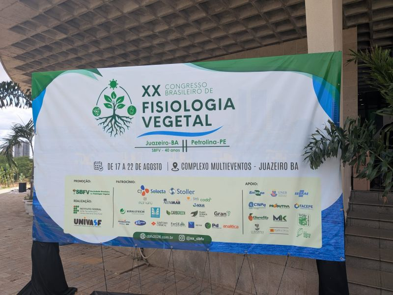
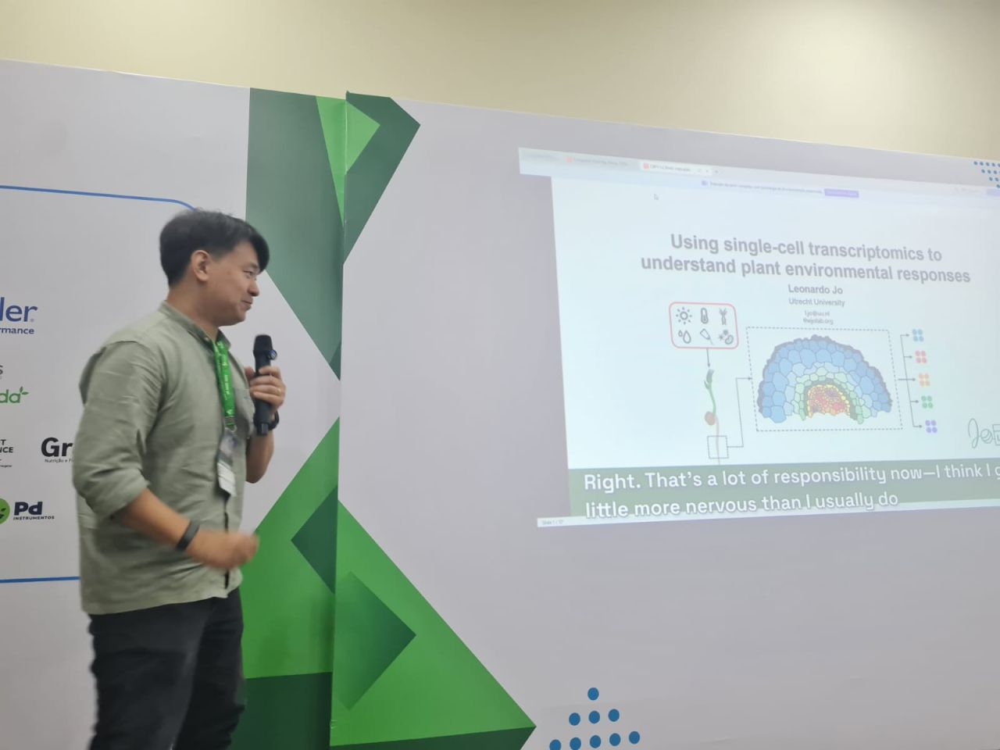
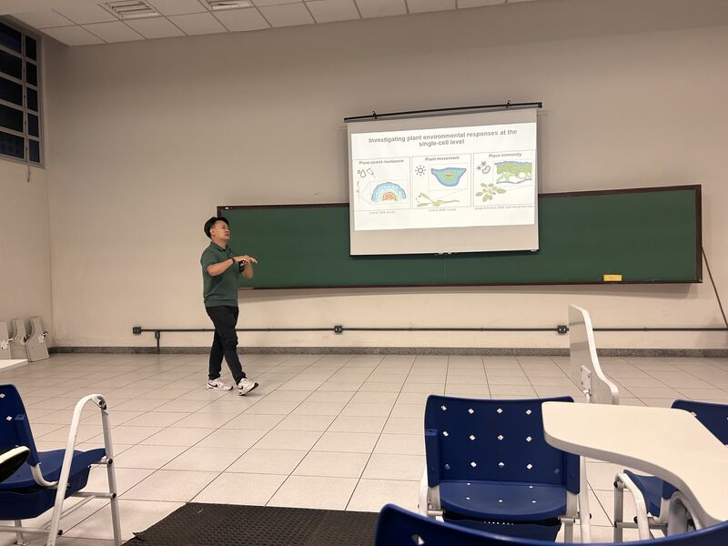
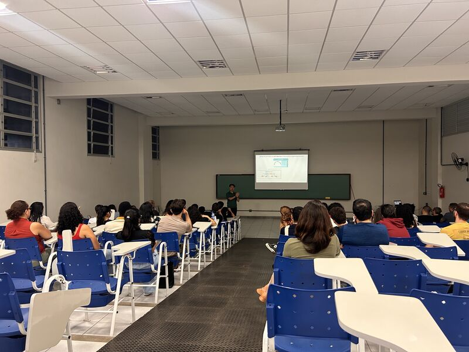
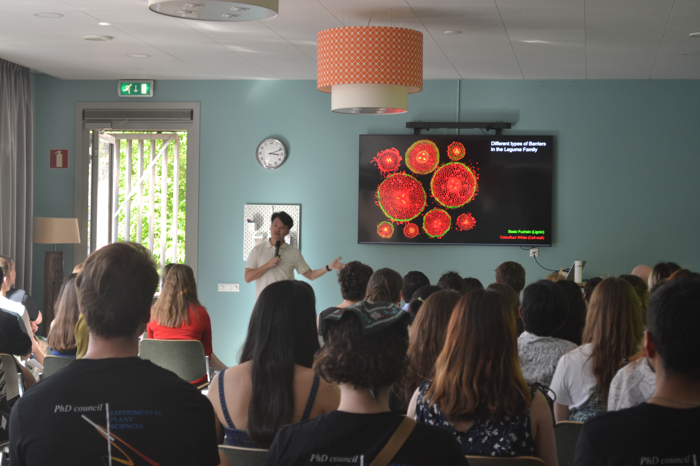
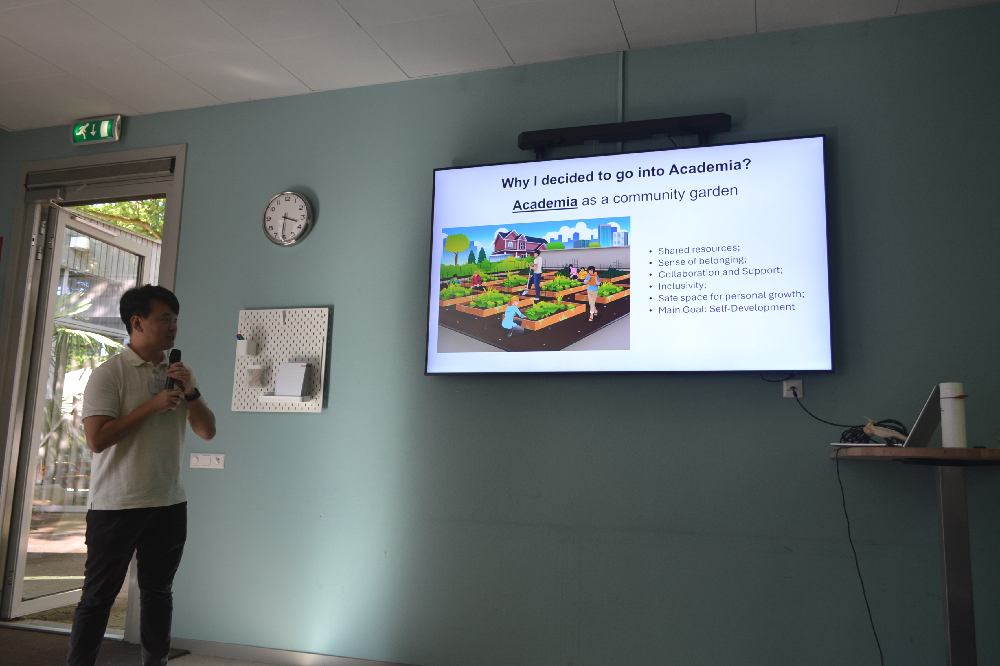
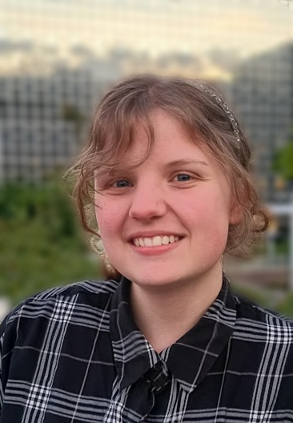
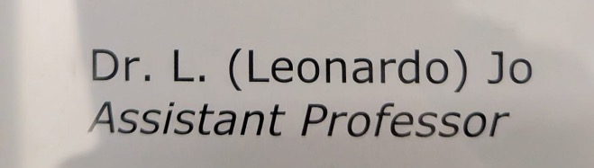
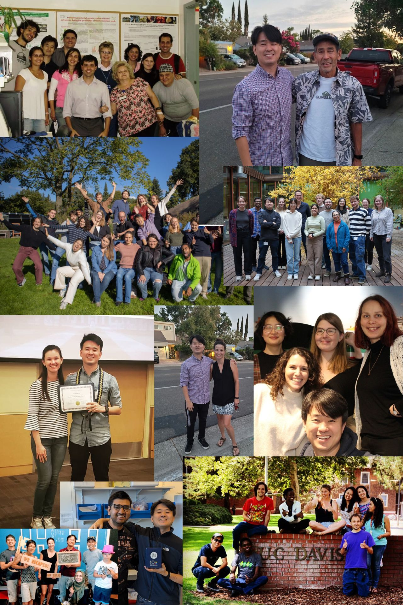

[ **Lab News**]{style="font-size: 24px;"}

------------------------------------------------------------------------

### **Nov 2026**
#### **New Team Members**

Very excited to welcome new team members.

1) Gabriele Panicucci join the team as a postdoc and he will work on establishing tools to study how epigenetic states shape plant stress transcriptional responses.

2) Laura Gerits started her PhD, where she will be investigating plant stress responses and transcription factor function using single-cell sequencing technologies.

3) Yulia Kiryukhina started her major MSc internship in our group. She will study mechanisms of epigenetic memory in plant stress responses. 

I'm very excited that the team is finally assembled! Looking forward for the cool things we will discover together!

------------------------------------------------------------------------

### **Oct 2026**
#### **New Pre-print!**

1) [Local and distal signals drive cell-type-specific leaf responses during shade avoidance](https://www.biorxiv.org/content/10.64898/2026.10.11.757655v1)

This work was lead by Lisa Oskam (WUR), Ronald Pierik (WUR) and myself. We present the first single-cell atlas of the leaf and petiole during a hyponastic response to far-red light. Our findings reveal important spatial insights into how Arabidopsis leaves process shade signals to coordinate upward movement and petiole elongation.

Some cool findings of the paper can be found in this [bluesky thread](https://bsky.app/profile/leonardojo.bsky.social/post/3my7slhm5sc2i)

------------------------------------------------------------------------

### **Sept 2026**
#### **New Publications!**

I'm very happy to announce two new publications!

1) [Progressive oxygenation of developing leaves directs morphogenesis](https://www.science.org/doi/full/10.1126/sciadv.aef2430)
2) [Cell-type-specific activation of broadly perceived effector-triggered immunity restricts pathogen invasion in plants](https://www.cell.com/cell-host-microbe/fulltext/S1931-3128(26)00310-0)

These are fruits of very nice collaborations from the groups of Daan Weits (UU) and Pingtao Ding (Leiden).
Check out the links above to dive into the details of how plants oxygen gradients shape plant development and how immune responses are specified in unique cell types of leaves!

------------------------------------------------------------------------

### **Aug 2026**
#### **Connecting with the Brazilian Plant Biology Community**
Over the past few weeks, I had the pleasure and privilege of presenting some of my work at the 20th Brazilian Congress of Plant Physiology, organized by the Brazilian Society of Plant Physiology (SBFV), and at the Graduate Program in Plant Physiology at the Federal University of Viçosa. 
It was a few weeks filled with great learning and inspiration!
Ever since I left Brazil in 2012, it has always been a personal goal of mine to stay connected with Brazilian scientific community. I am a direct product of the efforts of the SBFV, federal universities, and Brazilian public policies, so I am deeply committed to contributing to the development of students in Brazil.
Thank you so much for the invitation; you can always count on me for whatever you need!
May this be just the beginning of a long-lasting partnership.

{fig-align="left" width="420"}
{fig-align="left" width="420"}

{fig-align="left" width="420"}
{fig-align="left" width="420"}

------------------------------------------------------------------------

### **May 26th, 2026**
#### **Leo was invited as a guest speaker at the EPS Get2Gether 2026!**

Leo had a chance to talk about the research vision of the group on usingon single-cell sequencing to understand plant responses to abiotic stresses. 
He also spoke about the importance of building a phd community for the success of phd candidates.
This was a very nice opportunity to interact with young researchers!

{fig-align="left" width="420"}
{fig-align="left" width="420"}

------------------------------------------------------------------------

### **April 20th, 2026**
#### **Fieke started as a bachelor intern**

We are very happy to receive Fieke Douwes for her bachelor internship! 
She will be investigating cis-elements that are important to specify root cell identities in Arabidopsis. 
We are looking forward for the cool results she will find during her time in the group!

{fig-align="left" width="180"}

------------------------------------------------------------------------

### **April 15th, 2026**
#### **Our first ever Phd position is open!**

I'm very excited to announce that the Jo Lab is hiring our FIRST EVER PhD candidate!
Passionate about plant stress responses, molecular biology, and bioinformatics? Join our lab as PhD candidate and investigate why unique plant cells respond so differently to the same environmental stimuli. You’ll gain hands-on experience with cutting-edge single-cell genomics and functional genomics to uncover the drivers of plant transcriptional responses to the environment. If you're eager to drive discovery in plants, join us at UU Plants!

<a href=https://www.uu.nl/en/organisation/working-at-utrecht-university/jobs/phd-position-in-the-role-of-cell-identity-in-shaping-plant-stress-responses>More info</a>

------------------------------------------------------------------------

### **February 1st, 2026**
#### **The Jo Lab started!**

As of today, our lab started!
I'm super excited to join the Plant Stress Resilience group chaired by [**Rashmi Sasidharan**](https://www.linkedin.com/in/rashmi-sasidharan-9708ba9/). My research will focus on understanding how the interaction between transcription factors and chromatin states shape plant environmental responses. Since starting grad school I have dreamed about this moment and I hope to inspire the next generation of plant biologists with the same patience, care and dedication shown to me by the many mentors and colleagues who guided me throughout my journey.

{fig-align="left" width="306"}

{width="600"}

------------------------------------------------------------------------

### **November 1st, 2025**
#### **Leonardo Jo was awarded the prestigious VENI Grant**

The Veni Grant is part of the NWO Talent Program and it is aimed at newly promoted researchers. Researchers eligible for a Veni grant have academic qualities that clearly exceed what is usual. The funding amounts to a maximum of €320,000.

I'm very honored to have received this grant. We will focus in understanding the role of of pioneer factors in specifying chromatin accessible domains during developmental transitions.

[**More Information**](https://www.nwo.nl/en/researchprogrammes/nwo-talent-programme/projects-veni/veni-2024)
